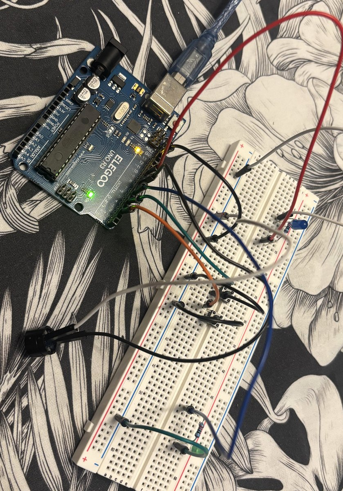

# Melody Buttons

Arduino Uno project with two buttons. Each button plays a different melody on a passive buzzer, and the LED next to it lights up while the melody is playing.

## Demo Version

**Wokwi simulation:** [open in Wokwi](https://wokwi.com/projects/480337136389853185)

## Parts

- Arduino Uno
- Passive buzzer
- 2x push button
- Green LED and blue LED
- 2x 200 Ω resistor (for the LEDs)
- Breadboard and jumper wires

## Wiring

| Component | Arduino pin | Connection |
|-----------|:-----------:|------------|
| Green button | 2 | other leg to GND |
| Blue button | 4 | other leg to GND |
| Green LED | 6 | pin → resistor → LED → GND |
| Buzzer | 8 | other leg to GND |
| Blue LED | 10 | pin → resistor → LED → GND |

The LED's longer leg (anode) faces the pin, the shorter one (cathode) goes to GND.

Circuit diagram for Wokwi: [`diagram.json`](diagram.json)

## How it works

- The buttons use `INPUT_PULLUP`, so a pressed button reads `LOW`.
- Blue button: the blue LED turns on, melody 1 plays, then the LED turns off.
- Green button: the green LED turns on, melody 2 plays, then the LED turns off.
- Each melody is stored in two arrays: `melody1[]` holds the notes (from `pitches.h`) and `durations1[]` holds their lengths (4 = quarter note, 8 = eighth note). Melody 2 works the same way.
- `tone()` plays each note, and there's a short pause after every note so they don't blend together.

## What I learned

This was one of my first Arduino projects. I didn't follow the usual order of learning LEDs first, then buttons, then buzzers. I had an idea, so I put everything together straight away and figured out the problems as they came up. It showed me that I can be creative with my projects instead of just sticking to the tutorial order.

## Next steps

- Use `millis()` instead of `delay()`, so a button can work while a melody is playing